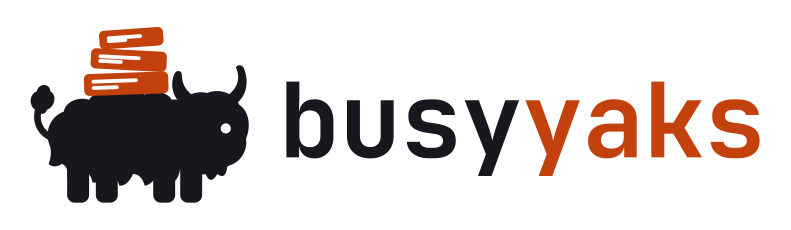
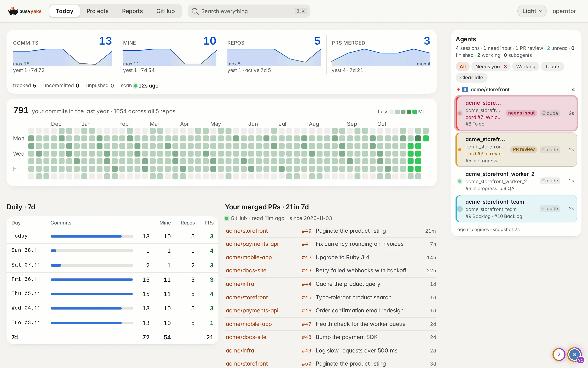
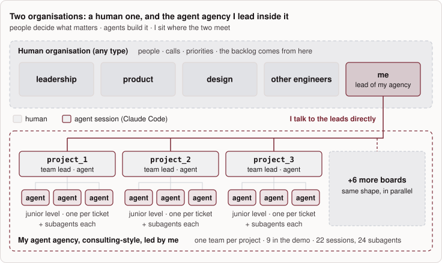
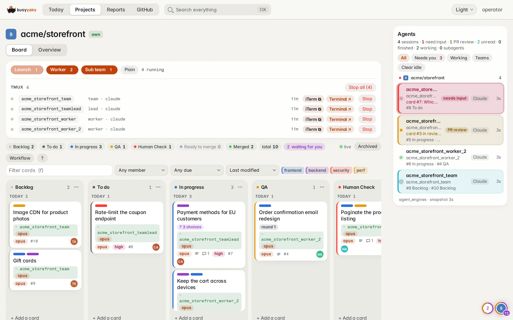
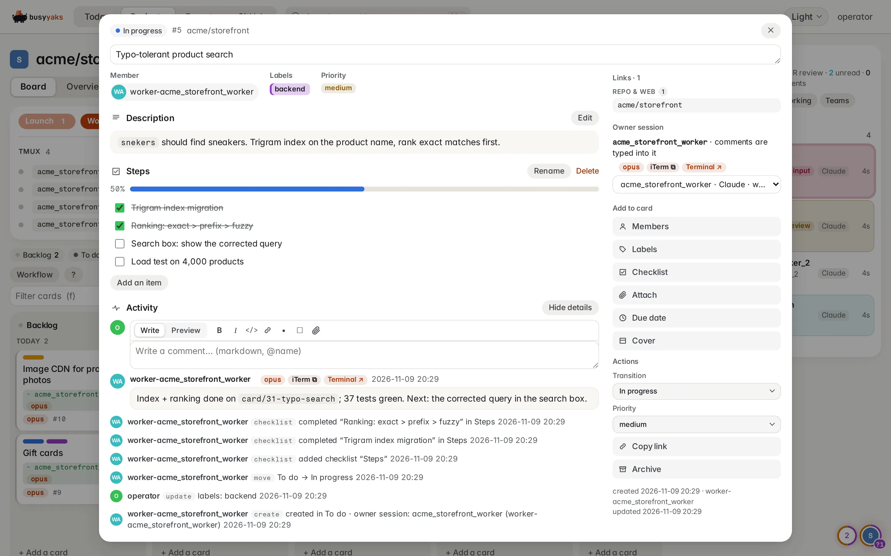
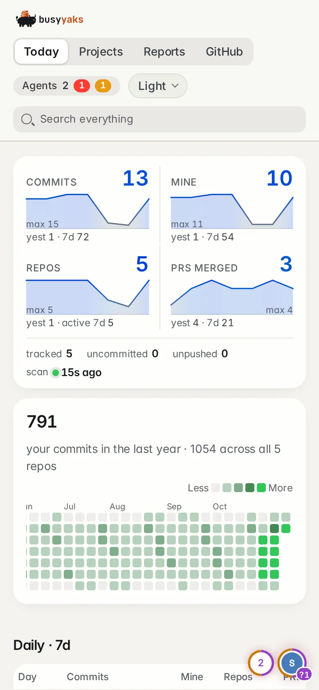
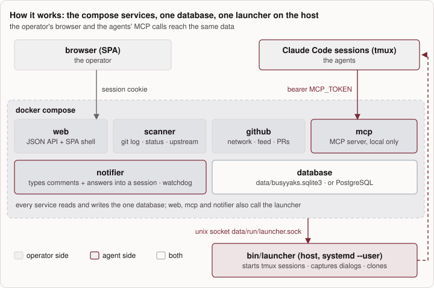

<div align="center">

<b>Read first: <a href="https://robertz.co/feeds/architecture/how-i-reached-100-prs-a-day/">How I reached 100 quality PRs a day with an agents kanban</a></b>

<picture>
  <source media="(prefers-color-scheme: dark)" srcset="public/static/logo-dark.svg">
  
</picture>

**Run your own agency, from your own machine, staffed by Claude agents.**

[](#tests-and-ci)
[](#tests-and-ci)
[](#tests-and-ci)
[](LICENSE)
[](#stack)
[](#stack)
[](#mcp-tools)
[](#hand-it-to-a-coding-agent)

[Quickstart](#quickstart) · [What you get](#what-you-get) · [How it works](#how-it-works) ·
[The board](#the-board-agents-and-the-operator) · [MCP tools](#mcp-tools) · [Configuration](#configuration) ·
[Docs](#documentation)

</div>

You are brilliant. The people around you just don't get it yet. Good news: you can vibe-code anything now, so stop
waiting for them. Be the boss. Hire a team of agents that never quiet-quit, believe in your vision and always agree
with you. :)

### Merge hundreds of PRs a day!

Always-busy yaks watch your projects locally and follow your orders. You focus on building the roadmap and managing
them.

The panel watches every git repo under a directory and gives you and your agents the same view of them:

- **Today**: commits, active repos and your merged PRs per day, a year-long contribution heatmap, and what is dirty or
  unpushed, so your brain gets its dopamine from the numbers!
- **A kanban board per repo**, the real diamond of this repo. An agent claims a card, asks you a question on it, and
  hands it over with the PR, the CI build and screenshots. It never merges before you approve, so you personally
  ensure the quality of your yaks' work.
- **Launch and supervise agents** in tmux from the browser, see which session is waiting on a permission dialog, and
  answer it from the card.
- **A daily report** written by a local LLM through the same MCP tools, with every number computed by the server.
- **Your GitHub network**: what the people you follow starred, whom they followed, and your github.com feed, summarised.

It runs as five Docker containers plus two host-side processes (the tmux launcher and, optionally, the daily-report
timer). All state is one database: a SQLite file by default, or PostgreSQL ([Database](#database)). It is built for
**one operator on one Linux box**: see [When not to use it](#when-not-to-use-it).

<p align="center">
  
</p>

<p align="center"><sub><b>Today</b> (light skin): the numbers come from the scanner's git reads and from GitHub, never
from a model. The right rail lists the live agent sessions per project. All screenshots show a throwaway demo deployment:
generated repos and commits, a fresh database, example accounts (<code>dev@example.com</code>, <code>acme/*</code>) — no real deployment's
data — regenerated with <a href="scripts/readme-images/build"><code>scripts/readme-images/</code></a>.</sub></p>

## The project

busyyaks is two repos that move together:

- [**busyyaks**](https://github.com/robertziel/busyyaks) (**this repo**) —
  the panel: one dashboard and MCP server over every project on a box, its agents and their boards.
  - [**busyyaks_agents_kanban_module**](https://github.com/robertziel/busyyaks_agents_kanban_module) — the kanban
    engine, vendored here as `agents_kanban` (Ruby module `AgentsKanban`).

The kanban module is built for and with busyyaks, its reference host; it lives in its own repo only so other projects
can ingest it too. See [Two layers](#two-layers-the-panel-and-the-kanban-module).

<p align="center">
  
</p>

<p align="center"><sub><b>How it is used</b>: one operator, one team-lead agent per project, a worker agent per card —
from <a href="https://robertz.co/feeds/architecture/how-i-reached-100-prs-a-day/">the article</a>.</sub></p>

---

## Requirements

| For | You need |
|---|---|
| the dashboard, scanner, MCP, boards | Linux, Docker with the compose plugin, `openssl`, a directory of git repos |
| signing in | nothing on localhost (`auth: { provider: none, allow_unauthenticated: true }`); anything reachable from elsewhere needs an [auth provider](#sign-in) |
| GitHub pages and merged PRs | a GitHub login and a read-only token (the Quickstart reads it with the [`gh` CLI](https://cli.github.com): `gh auth token`; any other read-only token works — then drop that line) |
| the launcher (`bin/launcher`, on the host): Launch, claim, dialog answers, new repos | Ruby 3.x, `git`, `tmux`, the `claude` CLI, a systemd user manager (`systemctl --user`; on a server without a login session: `loginctl enable-linger`) |
| the agents sidebar, typing comments into sessions (optional) | an **agent-session collector** ([below](#agent-sessions)) |
| the daily report (optional) | the runner's CLI (e.g. `hermes`), Ruby 3.x (`bin/env` reads `.env`), `jq`, `curl`, `flock`, `timeout` on the host, a systemd user manager, and an OpenAI-compatible LLM gateway |

### Agent sessions

An agent-session collector is a separate host program that walks `/proc` and tmux, writes a JSON snapshot of every
pane running a coding agent, and answers `screen` / `send` requests on a unix socket. The collector this project runs
with is not published yet, so you state which you have in `config/busyyaks.yml` `agents` (required, no default):

| `agents:` | |
|---|---|
| `{ collector: none }` (the shipped example) | works: dashboard, scanner, MCP, boards, Launch, `kanban_claim`, the watchdog, reports, GitHub; a dialog is turned into a question on its card (and answered from there) only when a comment to that session is pending. Off, each saying `agent-session collector off (config/busyyaks.yml agents.collector: none)` where it shows: the agents sidebar, session states and links on cards, Clear idle, the subagent list, typing card comments and answers into a session (the ping is marked failed with that reason), spotting a session stuck on a dialog before anyone comments |
| `{ collector: { snapshot: <file>, read_socket: <socket> } }` | everything; host paths read by `bin/launcher`, which refuses to start while either is missing |

---

## Quickstart

```bash
git clone https://github.com/robertziel/busyyaks && cd busyyaks

# fill in every value: compose, bin/launcher and bin/daily-report check them
cp .env.example .env
# roots, owner_remotes, author_emails, window_days, auth (none + allow_unauthenticated), agents (collector: none)
cp config/busyyaks.example.yml config/busyyaks.yml
# board-wide kanban settings: caps, theme, gates (the launchers + agent types are edited on Settings → Agents &
# launchers, saved in the database; a fresh one starts with config/agents.template.yml: plain `claude`)
cp config/kanban.example.yml config/kanban.yml

# secrets and the host user into .env (GITHUB_TOKEN: any read-only token; `gh auth token` with the GitHub CLI)
sed -i -e "s/^SESSION_SECRET=.*/SESSION_SECRET=$(openssl rand -hex 64)/" \
       -e "s/^MCP_TOKEN=.*/MCP_TOKEN=$(openssl rand -hex 32)/" \
       -e "s/^MCP_REPORT_TOKEN=.*/MCP_REPORT_TOKEN=$(openssl rand -hex 32)/" \
       -e "s/^GITHUB_TOKEN=.*/GITHUB_TOKEN=$(gh auth token)/" \
       -e "s/^HOST_UID=.*/HOST_UID=$(id -u)/" -e "s/^HOST_GID=.*/HOST_GID=$(id -g)/" .env
$EDITOR .env                  # PROJECTS_ROOT, GITHUB_LOGIN, TZ, LAUNCHER_RUN_DIR (a persistent dir, e.g. ~/.local/state/busyyaks/run written out), the rest; DATABASE_ADAPTER=sqlite as shipped (POSTGRES_* stay empty; PostgreSQL: see Database)

mkdir -p data                 # yours: the containers run as HOST_UID, never root
vars=$(bin/env LAUNCHER_RUN_DIR) && eval "$vars" && mkdir -m 700 -p "$LAUNCHER_RUN_DIR"   # the launcher socket's dir
docker compose up -d --build web mcp scanner github notifier
```

Open `http://127.0.0.1:$WEB_HOST_PORT` — with `provider: none` there is no sign-in. The scanner reads every repo under
`PROJECTS_ROOT` (mounted read-only) within `SCAN_INTERVAL_SECONDS`.

Connect Claude Code to the MCP server:

```bash
vars=$(bin/env MCP_HOST MCP_HOST_PORT MCP_TOKEN) && eval "$vars"   # bin/env: the one .env reader (host Ruby 3.x)
claude mcp add --transport http --scope user busyyaks "http://$MCP_HOST:$MCP_HOST_PORT/mcp" \
  --header "Authorization: Bearer $MCP_TOKEN"
```

Install the host launcher (systemd `--user`). Agents' board tools check the agent's tmux session through it, and the
launch bar starts sessions with it:

```bash
deploy/install-launcher.sh
```

An agent then starts with `whats_new` and works its project's board with the `kanban_*` tools. Without the launcher,
the dashboard, the scanner and MCP's read tools work, but agents cannot register, claim, create or ask on cards. The
agents sidebar and typing comments into sessions also need an [agent-session collector](#agent-sessions).

Optional: the [daily report](#the-daily-report) timer, `deploy/install-daily-timer.sh`.

---

## What you get

| Page | Shows |
|---|---|
| **Today** `/` | per-day commits · yours · active repos · your merged PRs over `window_days`; the year heatmap; tracked / uncommitted / unpushed counts; the last scan |
| **Projects** `/projects` | every repo: branch, last commit, window commits, dirty, unpushed, cards per column; launch agents; create or clone a repo |
| **Project** `/projects/<slug>` | **Board** (below) and **Overview**: the branch, commits and notes. A [Backlog.md](https://github.com/MrLesk/Backlog.md) `backlog/` folder shows its tasks on the board, read-only |
| **Reports** `/reports` | the daily reports and anything an agent posted with `post_report`; `/reports/components` is the block library |
| **GitHub** `/github` | the people you follow: their stars and new follows over 24h · 7d · 30d; your github.com feed summarised |
| **Agents** sidebar | every tmux session running a coding agent, by project, worst first: blocked (a dialog or a question) · review · working · finished · idle; links to its terminal and its Claude Code Remote Control session |

Two skins (light by default, dark, or follow the system), Trello-style keyboard shortcuts on the board (`?`), and a search
over projects, cards, commits and reports (`⌘K`).

<p align="center">
  
</p>

<p align="center"><sub><b>Board</b>: the launch bar starts a lead, worker, sub-team or plain session in
tmux; each card shows the session that owns it and whether anyone is listening.</sub></p>

<table>
  <tr>
    <td width="72%"></td>
    <td width="28%"></td>
  </tr>
  <tr>
    <td align="center"><sub><b>Card</b>: checklist, every move and comment with who made it, and the session comments are typed into.</sub></td>
    <td align="center"><sub><b>Phone</b>.</sub></td>
  </tr>
</table>

---

## How it works

<p align="center">
  
</p>

| Process | What it does |
|---|---|
| `web` | Serves the SPA shell for every signed-in GET and the `/api/*` JSON API. Markdown (reports, notes, cards) is rendered on the server with raw HTML dropped. |
| `mcp` | The MCP endpoint, local only. Refuses any request that carries an `Origin` header. |
| `scanner` | Every `SCAN_INTERVAL_SECONDS`: log, status and upstream of each repo under the configured roots. A repo is a dir with `.git`; group dirs are searched `search_depth` levels down. Every read is one short-lived child (`bin/git-read`, libgit2: it runs no program a repo's config names) with hard limits (`GIT_READ_*`); a repo it cannot read is an error on that repo, never the git CLI instead. |
| `github` | Every `GITHUB_INTERVAL_SECONDS`: the network, the feed, your merged PRs and PR states for the board. The only container that holds `GITHUB_TOKEN`; conditional requests (ETag) everywhere. |
| `notifier` | Delivers the operator's comments, moves and answers to the owning session; turns a session stuck on a dialog into a question on its card; releases cards whose session is gone. |
| `bin/launcher` | Runs on the host, because the containers cannot reach the host's tmux. Starts sessions, lists them, captures and answers dialogs, clones repos. |
| `bin/daily-report` | Runs on the host from a systemd timer. See [the daily report](#the-daily-report). |

### Stack

Hanami 2.3 · Puma · Sequel on SQLite or PostgreSQL · `ruby:3.4-slim` · minitest · React 18 + TypeScript + Vite (built in the image's
node stage) · vitest.

### Two layers: the panel and the kanban module

| Layer | Repo | Role |
|---|---|---|
| **Panel** | this repo | One dashboard and MCP server over **every** project on the box: scanner, Today, agents sidebar, launches, daily report, GitHub network, one board per project. |
| **Kanban module** | [busyyaks_agents_kanban_module](https://github.com/robertziel/busyyaks_agents_kanban_module) | The board itself: store, workflow, gates, session registry, notifier, `kanban_*` MCP tools, React board. busyyaks is its reference host. |

busyyaks keeps no kanban code of its own: it vendors a pinned module sha (`vendor/agents_kanban`,
`frontend/src/vendor/agents_kanban`, refreshed only by `scripts/vendor-kanban-engine.sh`) and supplies the host side:
its config (`config/kanban.yml` + the agent settings in the database), the launcher and the repo links. The two move together: a board change is a module
PR plus a busyyaks PR that re-vendors it, merged as one change. The module has its own repo so that other projects
can vendor it too.

---

## The board: agents and the operator

Every repo gets a board. The default columns are **Backlog → To do → In progress → QA → Human Check → Ready to merge →
Merged**. Columns, their types and the named transitions between them are stored in the database;
the operator edits them in a graph editor (the board's **Workflow** button).

| Who | Can |
|---|---|
| Agent (MCP) | create and claim cards, comment, attach files, move cards between the working columns; after approval, merge the PR and move the card from Ready to merge to Merged |
| Agent asks the operator | only through `kanban_ask(id, question, author, options?)`: the card keeps its column and is flagged as waiting for you; the options become buttons on the card |
| Agent → Human Check | only through `kanban_handoff` with the QA steps, the PR URL and the CI URL; a UI change is refused without screenshots |
| Operator (web) | everything, and is the only one who moves a card out of Human Check into Ready to merge. The agent merges only after that. |

Sessions are tied to cards. A session started from the launch bar is registered before tmux starts it. A **lead**
adopts the cards that wait for the operator. A **worker** is spawned for an ownerless card in a working column. A
**sub team** runs alongside the lead. Comments and answers are typed into the owner's tmux session; when nobody is
listening the card says so. Caps on concurrent sessions are config (`config/kanban.yml`, and per agent type on Settings → Agents & launchers): by default none, except one
lead per board.

The full contract is [`vendor/agents_kanban/SPEC.md`](vendor/agents_kanban/SPEC.md); the HTTP API is
[`docs/API-kanban.md`](docs/API-kanban.md).

---

## MCP tools

| Tool | Does |
|---|---|
| `whats_new(date?)` | that day's reports, commits per repo since midnight, dirty and unpushed repos, the last scan |
| `list_projects(own?, active_days?)` · `project(slug, limit?)` | repos with branch, last commit, window counts; one repo with commits and notes |
| `daily_facts(hours, series)` | the daily report's numbers, computed: commits vs the previous window, active repos, pending work, cards waiting for the operator |
| `github_network(hours)` | stars, follows and the feed in a window, plus a ready-made report block |
| `report_components()` · `check_report(body)` · `post_report(...)` | the report block library; a dry-run check of a draft; publish |
| `list_reports` · `get_report` · `add_note` · `list_notes` · `scan_now` | reports, notes, an immediate rescan |
| `daily_report_config()` | how the daily report runs here (`config/busyyaks.yml` `daily_report`, validated) |
| `kanban_*` (29 tools) | the board: `kanban_board`, `kanban_card`, `kanban_create`, `kanban_claim`, `kanban_comment`, `kanban_ask`, `kanban_handoff`, `kanban_move`, labels, checklists, due dates, attachments, `kanban_workflow` |

The server's `instructions` tell an agent how to use the board: claim before working, ask on the card instead of in
chat, hand off with `kanban_handoff`, and never poll.

---

## The daily report

Optional, configured by `daily_report` in `config/busyyaks.yml`. `bin/daily-report` runs on the host from a systemd
user timer (`deploy/install-daily-timer.sh`): it probes your OpenAI-compatible gateway and starts a runner (today:
[Hermes](https://github.com/NousResearch/hermes-agent)) whose only tools are the busyyaks MCP server and read-only
`git log` / `git status`. The model writes the prose; every figure comes from `daily_facts`, and `check_report`
rejects a draft that names repos, people or events the server does not know. A gateway that is down means no report
(or one `NOT RUN` report after the cutoff), never a stand-in model.
Details: [`docs/DAILY-REPORT.md`](docs/DAILY-REPORT.md).

---

## Configuration

A deployment is configuration, never code. One place per value; an unknown or missing key is an error.

| File | Holds |
|---|---|
| `.env` (from [`.env.example`](.env.example)) | wiring and secrets: ports, `PROJECTS_ROOT`, the host user the containers run as (`HOST_UID`/`HOST_GID`), timezone, session secret, `MCP_TOKEN`, GitHub login and token, intervals, attachment limits. Compose uses `${VAR:?}`, so a missing value stops it. |
| `config/busyyaks.yml` (from [`config/busyyaks.example.yml`](config/busyyaks.example.yml)) | repo roots and search depth, your remotes and author emails, the history window, `reap_protect` (sessions "Clear idle" never stops), `auth` ([Sign-in](#sign-in)), `agents` ([Agent sessions](#agent-sessions)), optional `engines:` and `daily_report` (a bad one stops the scanner and github services at boot and fails the `daily_report_config` tool). |
| `config/engines.yml` (committed) | the coding-agent engine names a collector reports → sidebar label + behaviour family (`claude` · `hermes`); `engines:` in `config/busyyaks.yml` adds or relabels. |
| `config/kanban.yml` (from [`config/kanban.example.yml`](config/kanban.example.yml); the file `KANBAN_CONFIG` names) | the kanban module's host settings: concurrency caps, theme, the handoff / approval gates, the review loop. Not the launchers and agent types: they are rows in the database, edited on **Settings → Agents & launchers** (the header's cog). |
| Settings → Agents & launchers (`/settings`; repo default [`config/agents.template.yml`](config/agents.template.yml)) | the launchers (the commands that start an agent session: kind `claude_code` or `hermes`, command, args, via shell) and the agent types (their launchers, model per launcher, prompt, caps). Every save is a new revision (history kept). A launcher is one of the invocations on `config/busyyaks.yml` `launch.commands`, **the host allowlist** (each a whole `{kind, command, args, via_shell}`): the page offers only those, and anything else is refused when saved and again by `bin/launcher` when it starts — no dashboard user can add an argument the host did not list. The fresh database runs plain `claude` in Claude Code's default permission mode (a permission prompt becomes a question on the card). |

### Database

`.env` `DATABASE_ADAPTER` picks it; there is no default, the shipped `.env.example` says `sqlite`.

| `DATABASE_ADAPTER` | Keys (`.env`) | What runs |
|---|---|---|
| `sqlite` | `SQLITE_BUSY_TIMEOUT_MS` | `data/busyyaks.sqlite3`, nothing else. WAL, every transaction `BEGIN IMMEDIATE` ([`docs/DEPLOY.md`](docs/DEPLOY.md#the-database)) |
| `postgresql` | `POSTGRES_HOST` · `POSTGRES_PORT` · `POSTGRES_DB` · `POSTGRES_USER` · `POSTGRES_PASSWORD` (the password only in `.env`) · `POSTGRES_LOCK_TIMEOUT_MS` | your server, or the compose `postgres` service: `COMPOSE_PROFILES=postgres`, `POSTGRES_HOST=/data/postgres-run`, `POSTGRES_PORT=5432` (runs as `HOST_UID`, cluster in `data/postgres`, a Unix socket, no network) |

Every key stays in `.env`; the chosen adapter's must be filled (a missing, empty or unknown value stops every service
at boot). Switching starts on an empty database, unless you copy it: `bin/db-copy-sqlite-to-postgres` moves a SQLite
file into an empty PostgreSQL database and verifies every table ([runbook](docs/DEPLOY.md#switching-sqlite--postgresql-one-time-the-data-moves)).
CI runs the full test suite on both (`ruby` = SQLite, the public default; `ruby-pg` = PostgreSQL).

Some `.env` values point at tools outside busyyaks; every one is required:

| Key | What to put there |
|---|---|
| `TEAM_TERMINAL_URL` | a web terminal that opens a tmux session (`{session}`, `{socket}`); behind the board's **Terminal** links. Without one, any URL: the links just won't work. |
| `SSH_ATTACH_TEMPLATE` | the command the **iTerm** button copies, e.g. `ssh -t your-host tmux attach -t {session}` |
| `CLAUDE_SESSIONS_DIR` · `CLAUDE_SESSION_URL` | where Claude Code keeps its live session records, and the Remote Control URL (`{id}`) behind the **Claude** links |

Comments and answers are typed only into panes whose engine is in the `claude` family; for any other pane the
launcher answers `cannot type into <engine> (family hermes)` or `(not configured)` and nothing is typed.

---

## Sign-in

Sign-in is a pluggable **auth provider**, chosen in `config/busyyaks.yml` `auth`. There is no default: a missing
`auth` key, an unknown provider or settings the provider refuses stop the boot.

| `auth:` | What it does |
|---|---|
| `{ provider: none, allow_unauthenticated: true }` (the shipped example) | no sign-in: every request is the operator (shown as `operator`); no sign-out. The opt-in key is required (`provider: none` alone stops the boot) and every boot logs `*** AUTH DISABLED … ***`. Keep the dashboard on localhost or behind your own SSH tunnel; never behind a public proxy ([`docs/DEPLOY.md`](docs/DEPLOY.md)) |
| `{ provider: <dir>, <settings…> }` | a custom provider: `<dir>` (e.g. `auth/myidp`) holds `provider.rb`, a `Busyyaks::Auth::Provider` subclass; the block's other keys are its settings. How to write one: [`docs/AUTH.md`](docs/AUTH.md) |


The MCP endpoint does not use sign-in: it takes a bearer token (`MCP_TOKEN`), listens on `127.0.0.1` only, and should
never be exposed. The daily report has its own bearer, `MCP_REPORT_TOKEN`, which reaches only the report's tools (reads,
`check_report`, `post_report`): its model reads untrusted text, so it never gets a tool that writes a card.

---

## Running in production

- All ports bind to `127.0.0.1`. **Localhost only is the default** and needs nothing more. To reach the dashboard
  from elsewhere, use same-host nginx + TLS or an frp tunnel to a public proxy host: [`docs/DEPLOY.md`](docs/DEPLOY.md).
  `deploy/` has templates only; `bin/render-deploy` fills them from `.env` into `deploy/rendered/` (gitignored).
- The two host processes are systemd `--user` units: `deploy/install-launcher.sh` and `deploy/install-daily-timer.sh`.
  The launcher unit uses `KillMode=process`, so restarting it leaves your tmux sessions running.
- Back up `data/` (card attachments, and the SQLite file: `VACUUM INTO` while it runs, [`docs/DEPLOY.md`](docs/DEPLOY.md#the-database)) — on PostgreSQL, the server too (`pg_dump`). Migrations run when `web` starts.
- The containers run as `HOST_UID:HOST_GID`, the launcher's user. Every service (`bin/entrypoint`) refuses to start
  while anything under `data/` belongs to another user or cannot be read (a `data/` Docker created as root, files from
  a version whose containers ran as root, a directory without read permission) and prints the one-time fix:
  `docker compose run --rm --no-deps --user root web sh -c 'chown -R <uid>:<gid> /data && chmod -R u+rwX /data'`.
- Repos are mounted read-only. busyyaks never changes an existing repo (agents do, in their own tmux sessions); the
  launcher can create or clone a new one when you ask it to from the Projects page.
- Remote URLs are stored without credentials, so a token inside an https remote never reaches the database.

---

## Tests and CI

```bash
# lint · ruby (SQLite) · ruby-pg (PostgreSQL) · frontend · audit · secrets, all in Docker
scripts/ci/test.sh all
# RuboCop only (Cookpad's style guide); -a autocorrects
scripts/lint/rubocop [-a] [paths]
# pre-commit: overcommit in Docker — RuboCop, ESLint, Prettier, gitleaks, ShellCheck on the staged files
git config core.hooksPath .githooks
# once per worktree, and after a change to .overcommit.yml (signed config)
scripts/hooks/run sign
```

The suite runs in its own image, never touching a running deployment, on every CPU, with a coverage floor. The badges
at the top show the last green build of the default branch. Stages, parallelism, coverage and badges:
[`docs/TESTING.md`](docs/TESTING.md); lint rules and hooks: [`docs/LINT.md`](docs/LINT.md).
Two runners run the same script: **GitHub Actions** ([`.github/workflows/ci.yml`](.github/workflows/ci.yml): every
pull request, forks included, and every push to `main`, on `ubuntu-latest`; check `gates` (workflow `ci`)) and **Jenkins**, the
maintainer's runner (the `Jenkinsfile`, status `jenkins/ci`, which also refreshes the badges). Any other CI that can
run Docker can run it too. The Actions job runs on public repositories only; a private copy (a private local repo, a private fork)
skips it — no minutes spent — unless its repository variable `CI_ON_PRIVATE` is `true`. While a repository is
private the check shows as skipped, and a skipped check satisfies a required one: there, require `gates` only with
`CI_ON_PRIVATE` set.

**Docker access = root.** `scripts/ci/test.sh` starts containers on the Docker daemon, and the Ruby stage mounts the
daemon's socket (`/var/run/docker.sock`) into a container (compose) that builds and runs the checkout's code as root.
Whoever controls that code controls the host: run it on a disposable machine (a GitHub-hosted runner) or on a CI host
that builds trusted branches only.


---

## Design rules

- **No fallbacks.** A missing env or config key stops boot; so does a missing `auth` provider (no auth is a choice you
  write down). A failed scan or GitHub read is recorded and shown next to the last good one. Nothing substitutes a
  default, a cached value or a guess.
- **Unknown is not zero.** A branch with no upstream has `unpushed` = unknown (shown `—`), and a day the PR search
  did not cover shows `—`, never 0.
- **Numbers come from the server.** Reports and pages show computed figures; a model never counts.
- **Agents never approve their own work.** Only the operator moves a card past Human Check.

---

## When not to use it

- **A team.** One operator: everyone the auth provider lets in sees and does the same; there are no roles beyond
  operator and agent.
- **Not Linux, no tmux, no Claude Code.** The launcher drives tmux, confirms sessions through `/proc`, and types only
  into Claude Code panes.
- **Public, with no identity provider.** `none` is for localhost; a public deployment needs a provider you write
  ([Sign-in](#sign-in)).
- **Repos spread over many machines.** The scanner reads one directory tree on the box it runs on.
- **A public endpoint for agents.** The MCP server is for local sessions only; never tunnel it.

---

## Hand it to a coding agent


The repo is built to be worked on by agents. A prompt to start from:

```text
Set up busyyaks (this repo) on this machine and get its tests green.
1. Read README.md and .env.example.
2. cp .env.example .env, config/busyyaks.example.yml to config/busyyaks.yml and
   config/kanban.example.yml to config/kanban.yml; fill them for this box (launch.commands: the invocations an agent
   launcher may be, as in the example; the launchers themselves are set on Settings → Agents & launchers):
   PROJECTS_ROOT = <dir holding my repos>, GITHUB_LOGIN = <login>;
   keep `auth: { provider: none, allow_unauthenticated: true }` (localhost) and `agents: { collector: none }` unless I name a collector.
   Generate SESSION_SECRET, MCP_TOKEN and MCP_REPORT_TOKEN with openssl rand; HOST_UID/HOST_GID = id -u / id -g;
   LAUNCHER_RUN_DIR = ~/.local/state/busyyaks/run written out (persistent; outside this checkout and PROJECTS_ROOT; mkdir -m 700).
   Ask me for anything you cannot fill.
3. Run scripts/ci/test.sh all (Docker only; install nothing on the host) and report pass/fail counts.
4. mkdir -p data and LAUNCHER_RUN_DIR (-m 700); docker compose up -d --build web mcp scanner github notifier;
   check http://127.0.0.1:$WEB_HOST_PORT/up is 200.
Do not edit vendor/agents_kanban or frontend/src/vendor: they are vendored copies.
```

Tools for agents working on busyyaks itself: `bin/qa-cookie` prints a signed-in session cookie for headless browser
QA, and `bin/rename-project` moves a project's slug in the database after a repo rename.

---

## Documentation

| Doc | |
|---|---|
| [`docs/DEPLOY.md`](docs/DEPLOY.md) | localhost (default), same-host nginx + TLS, or an frp tunnel |
| [`docs/AUTH.md`](docs/AUTH.md) | writing an auth provider |
| [`docs/DAILY-REPORT.md`](docs/DAILY-REPORT.md) | how the daily report runs, tick by tick |
| [`docs/TESTING.md`](docs/TESTING.md) · [`docs/LINT.md`](docs/LINT.md) | test stages, parallelism, coverage · lint rules and git hooks |
| [`docs/API-kanban.md`](docs/API-kanban.md) | the board's HTTP API |
| [`vendor/agents_kanban/SPEC.md`](vendor/agents_kanban/SPEC.md) | the kanban module's contract |
| [`.env.example`](.env.example) · [`config/busyyaks.example.yml`](config/busyyaks.example.yml) · [`config/kanban.example.yml`](config/kanban.example.yml) | every setting |


---

## Contributing

Issues and pull requests are welcome: [CONTRIBUTING.md](CONTRIBUTING.md) has the setup (hooks included), the checks a
pull request must pass (`scripts/ci/test.sh all` green; it needs only Docker, and access to its socket is root on that
machine — see [Tests and CI](#tests-and-ci); the same gates run on your PR in GitHub Actions), the vendoring rule
(kanban module changes go to [busyyaks_agents_kanban_module](https://github.com/robertziel/busyyaks_agents_kanban_module)
first) and the commit style. Everyone taking part follows the [Code of Conduct](CODE_OF_CONDUCT.md). Changes:
[CHANGELOG.md](CHANGELOG.md).

## Security

Report a vulnerability privately, never in a public issue: [SECURITY.md](SECURITY.md) has how, what is supported and
what is in scope. Keep the MCP endpoint local and `provider: none` on localhost.

---

## License

[Apache License 2.0](LICENSE). Inter and Fragment Mono (`public/static/fonts/`) are under the SIL Open Font License
1.1. The vendored kanban module (`vendor/agents_kanban`, `frontend/src/vendor/agents_kanban`) is Apache-2.0 too; each
copy carries its `LICENSE`. The RuboCop rules in `config/rubocop/cookpad.yml` are Cookpad's style guide, CC BY 3.0;
`lib/busyyaks/agent_screen.rb` is a port of herdr's screen detection, Apache-2.0. Sources and paths: [NOTICE](NOTICE);
dependency licenses: [docs/DEPENDENCY-LICENSES.md](docs/DEPENDENCY-LICENSES.md).
